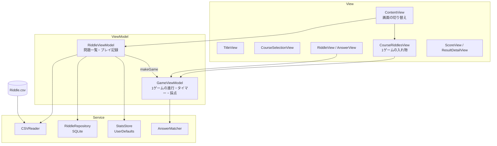
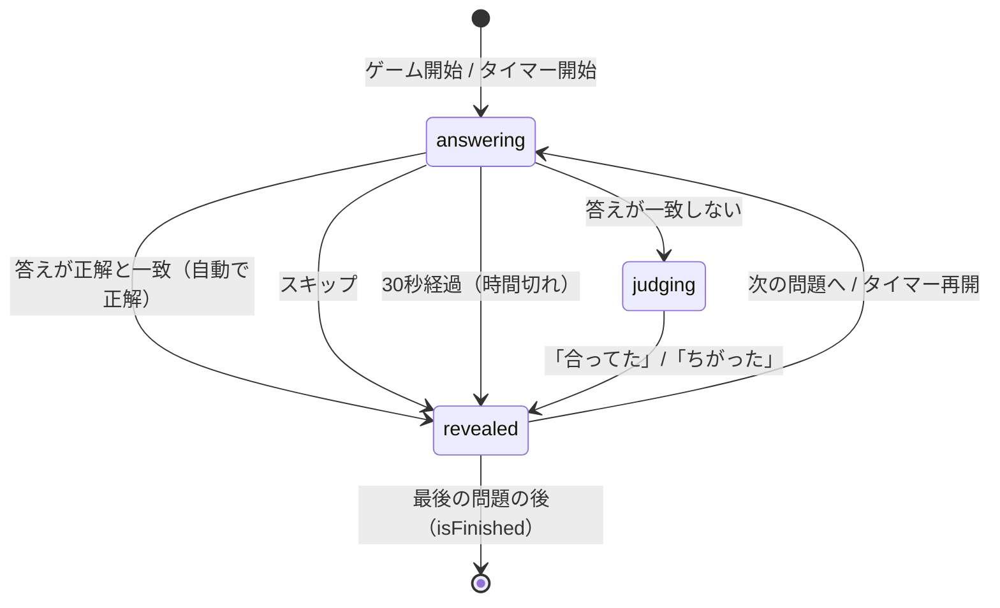

# アーキテクチャ設計書

## 1. 全体像

SwiftUI + MVVM の構成です。画面（View）は表示と入力だけを担当し、状態とロジックは ViewModel と Service に置きます。

## 2. レイヤーごとの責務

### Models（`AiRiddleApp/Models`）

| 型 | 役割 |
| --- | --- |
| `Riddle` | 1問分のデータ（id・問題文・AIの答え・正解）。`truth` / `ai` で答えと解説に分けたものを返す。`isAICorrect` で AI が正解しているかを判定 |
| `AnswerText` | 「答え。解説…」形式の文字列を、最初の「。」で答えと解説に分けたもの |
| `RiddleResult` | 1問の結果（問題・ユーザーの答え・`Outcome`）。`Outcome` は `correct` / `incorrect` / `timeUp` / `skipped` |
| `GameSummary` | 1ゲームの結果（正解数・AIの正解数・勝敗・ベスト更新か） |
| `Course` | コースの定義（問題数・名前・アイコン・色）。コースを増やすときはここに case を足す |

### Services（`AiRiddleApp/Services`）

| 型 | 役割 |
| --- | --- |
| `CSVReader` | バンドル内の `Riddle.csv` を読み込み `RiddleSeed` の配列にする。ダブルクォートで囲んだカンマ・改行に対応 |
| `RiddleRepository` | SQLite（SQLite.swift）への保存・取得。`sync(with:)` で CSV の内容に DB を合わせる |
| `StatsStore` | プレイ記録（`PlayStats`）を UserDefaults に JSON で保存 |
| `AnswerMatcher` | ユーザーの答えと正解を、表記ゆれを吸収して比較する |

### ViewModels（`AiRiddleApp/ViewModels`）

| 型 | 生存期間 | 役割 |
| --- | --- | --- |
| `RiddleViewModel` | アプリ起動中ずっと（`ContentView` の `@StateObject`） | 起動時に CSV → DB を同期して問題を読み込む。コースに応じた `GameViewModel` を作る。ゲーム終了時に記録を保存し `GameSummary` を返す |
| `GameViewModel` | 1ゲームの間だけ | 出題順・現在の問題・入力中の答え・残り時間・結果一覧を持つ。回答・自己判定・スキップ・次へ・時間切れの処理 |

依存はコンストラクタで渡せるようにしてあり（`RiddleRepository(fileURL:)`、`StatsStore(defaults:)`）、テストでは一時ファイルと専用の UserDefaults を使います。

### Views（`AiRiddleApp/Views`）

画面ごとにフォルダを分けています。各画面の仕様は [screens.md](screens.md) を参照してください。

- 画面の切り替えは `NavigationView` を使わず、`ContentView` の `Screen` 列挙型（`title` / `courseSelection` / `playing`）で行います。
- 共通の見た目は `Components/AppStyle.swift`（`PrimaryButtonStyle`、`SecondaryButtonStyle`、`cardStyle()`、`readableWidth()`）にまとめています。新しい画面でもこれを使ってください。

## 3. ゲーム進行（GameViewModel の状態遷移）

- 結果（`RiddleResult`）は `revealed` に入るときに **1問につき1回だけ** 記録されます。
- `judging` 中はタイマーが止まり、正解・AIの答えを見ながら自分で正誤を判断します。
- 制限時間は `GameViewModel.timeLimit`（30秒）。終了時刻（deadline）との差で残り時間を計算するため、処理の遅れで時間がずれません。
- `isFinished` になると `CourseRiddlesView` が `RiddleViewModel.record(_:)` を呼び、結果画面に切り替えます。

## 4. 起動時の処理

1. 利用規約に同意していなければ（UserDefaults の `hasAgreedToTerms`）同意画面を表示
2. `RiddleViewModel` を生成
   1. `CSVReader.loadRiddles()` で CSV を読み込み
   2. `RiddleRepository.sync(with:)` で DB に反映（追加・更新・削除）
   3. `fetchAll()` で問題一覧を読み込み
   4. `StatsStore.load()` でプレイ記録を読み込み
3. タイトル画面を表示。画面下部に広告バナー（`safeAreaInset`）

## 5. 外部ライブラリ

CocoaPods で管理しています（`Podfile`）。

| ライブラリ | バージョン | 用途 |
| --- | --- | --- |
| SQLite.swift | 0.14.1 | 問題データの保存 |
| Google-Mobile-Ads-SDK | 10.14.0 | バナー広告 |

`Podfile` の `post_install` で、すべての Pod の最低対応バージョンを iOS 15.0 にそろえています（新しい Xcode が古い対応バージョンのビルドを受け付けないため）。

## 6. 設計上の判断メモ

- **CSV を正とする**：問題の追加・修正・削除はすべて CSV で行い、DB は起動時に CSV に合わせます。DB を直接編集する処理はありません。
- **問題文がキー**：DB の行は問題文で突き合わせます。問題文を変えると「別の問題」として扱われ、古い行は削除されます（プレイ記録は問題ごとには保存していないので影響はありません）。
- **答えの判定は寛容に、最後はユーザーに委ねる**：なぞなぞは言い回しが多様なため、表記ゆれを吸収しても一致しない場合は、ユーザー自身に「合ってた／ちがった」を選んでもらいます。
