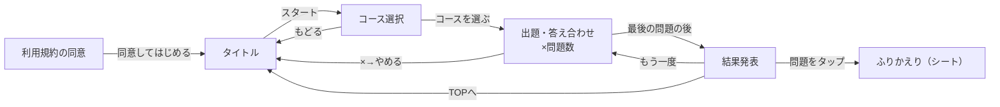

# 画面仕様書

## 画面遷移

利用規約の同意画面は初回のみ表示されます。同意済みの場合、広告バナーが全画面の下部に表示されます。

---

## 利用規約の同意（`TermsAndPrivacyAgreementView`）

| 要素 | 動作 |
| --- | --- |
| 利用規約 / プライバシーポリシー | シートで本文を表示（`TermsView` / `PrivacyPolicyView`、共通レイアウトは `LegalDocumentView`） |
| 同意してはじめる | `hasAgreedToTerms = true` を保存してタイトルへ |

## タイトル（`TitleView`）

- アプリ名とアイコン（上下にゆっくり動くアニメーション）
- 1回以上プレイしていれば記録を表示：プレイ回数・正答率・AIに勝った回数
- 「スタート」でコース選択へ

## コース選択（`CourseSelectionView`）

| コース | 問題数 | 色 |
| --- | --- | --- |
| おためしコース | 5 | ティール |
| 10問コース | 10 | 緑 |
| 20問コース | 20 | ピンク |

- 各コースにベストスコア（未プレイなら `--`）を表示
- 問題が読み込めなかった場合はボタンを無効化し、エラーメッセージを表示

## 出題・答え合わせ（`RiddleView` + `AnswerView`）

1問ごとに 1 画面です。`GameViewModel.phase` によって表示が変わります。

### 共通のヘッダー

- 左：× ボタン → 「ゲームをやめますか？」の確認（やめるとその回の記録は保存されない）
- 中央：第 n 問 / 全問題数
- 右：ここまでの正解数
- 残り時間のバー：10秒未満でオレンジ、5秒未満で赤

### phase = answering（回答中）

- 問題カード
- 入力欄：表示時に自動でキーボードが開く。キーボードの「完了」でも回答できる
- 「こたえる」：入力が空のときは無効
- 「わからない（スキップ）」

### phase = judging（自己判定）

自動判定で一致しなかったときに表示します。タイマーは止まっています。

- 正解・AIのこたえ・あなたのこたえのカード
- 「あなたのこたえは合っていましたか？」→「合ってた」/「ちがった」

### phase = revealed（結果表示）

- 結果メッセージ：正解！（緑）/ ざんねん…（赤）/ 時間切れ！（オレンジ）/ スキップ（グレー）
- カード
  - **せいかい**：正解と、開閉できる解説
  - **AIのこたえ**：AI の答えと解説。「AIも正解」/「AIはまちがい」のバッジ
  - **あなたのこたえ**：入力した答え（なければ「（未回答）」）。結果に応じたバッジ
- 「次の問題へ」（最後の問題では「結果を見る」）

## 結果発表（`ScoreView`）

- あなた vs AI の正解数と勝敗（AIに勝った！ / AIと引き分け / AIの勝ち…）
- 過去のベストを上回ったときは「ベスト記録更新！」（初回プレイでは表示しない）
- ふりかえり一覧：各問題の結果アイコンと問題文。タップで「ふりかえり」シート（`ResultDetailView`）に問題と答え合わせを表示
- 下部固定ボタン：「TOPへ」/「もう一度」（同じコースで新しい問題を出題）

## 共通の UI ルール

- 横幅は最大 640pt（iPad でも読みやすい幅）。`readableWidth()` を使う
- ボタンは `PrimaryButtonStyle`（塗り）と `SecondaryButtonStyle`（枠線）
- 正解・不正解・タップ時に触覚フィードバック（`Haptics`）
- 文字サイズはシステムの Dynamic Type に追従するフォントを使う
